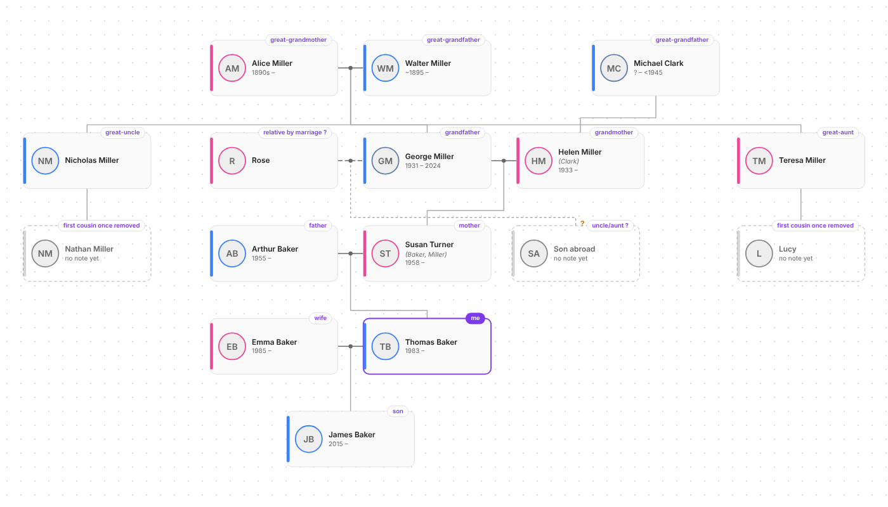
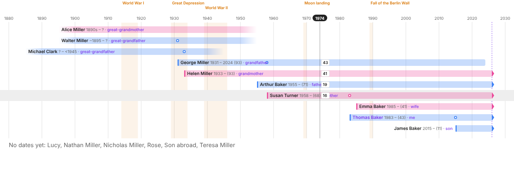

# Family Tree Diagram for Obsidian

Turns your person notes into an interactive family tree.



## How it reads your notes

A note is a person when it has `type: family-tree`, or the `#family-tree` tag plus at least one relation or date (so overview notes tagged `#family-tree` aren't drawn as people). Relations come from the frontmatter:

```yaml
birth_date: 1931-11-09
birth_place: "[[Leeds, England]]"
death_date: 2024-03-03
child_of: ["[[Walter Miller]]", "[[Alice Miller]]"]
parent_of: "[[Susan Turner (Baker, Miller)]]"
married_to: "[[Helen Miller (Clark)]]"
siblings:
  - "[[Nicholas Miller]]"
  - "[[Teresa Miller]]"
type: family-tree
gender: m        # optional; for Russian names it's guessed from the patronymic (…вич / …вна)
photo: "[[george.jpg]]"  # optional, otherwise the first image embedded in the note
```

- **One side is enough.** `parent_of` on the father implies `child_of` on the daughter, `married_to` works both ways, and so on.
- If a child lists only one parent and that parent has exactly one spouse, the child is drawn under the couple (can be turned off in settings).
- Siblings with no known parents are kept together under a hollow "unknown parents" dot.
- The part in parentheses in the note name is shown as previous/maiden surnames.
- People who are linked but have no note yet appear as dashed cards. **Click one to create its note**, pre-filled with the relations already known.

All property names are configurable in settings.

### Uncertain links and approximate dates

Put a `?` (or "maybe", "possibly", "возможно", "предположительно"…) next to a link to mark it as unconfirmed. It's drawn dashed with a **?**, and isn't used to guess the second parent:

```yaml
parent_of:
  - "[[Susan Turner (Baker, Miller)]]"
  - "[[Son abroad]] ?"
```

Dates may be approximate: `около 1895` / `1895?` → **~1895**, `до 1941` → **<1941**, `после 1945` → **>1945**, `1890-е` → **1890-е**, `1890–1895` → **~1890**.

Two people who share a child but aren't `married_to` each other are joined by a dashed line.

## Relationship labels

Right-click your own card → **This is me** (or Settings → Me, or the command *Set current note as me*). Every card then shows how that person is related to you — отец, двоюродная тётя, троюродный брат, внучатый племянник, тесть, свекровь, золовка, сват, муж тёти… (Russian or English, see settings).

- Hover any card to highlight the chain of people connecting it to you.
- Right-click → **Show relationships to this person** to see the tree from someone else's point of view (✕ in the toolbar to go back).
- The tag button in the toolbar toggles labels. In code blocks use `labels: false`.
- Labels ending in **?** go through an uncertain link.

## Timeline

The calendar button in the toolbar (or the command **Open family timeline**) switches the view to lifelines on a time axis.



- Each person is a bar from birth to death. Approximate dates fade out, people still alive end in an arrow at today, and someone with no death date who'd be over 105 gets a faded end.
- Circles on a bar are that person's children being born (hover for name and the parent's age).
- Move the mouse over the chart: a cursor shows the year and **everyone's age at that moment**.
- Historical events are shaded bands; edit them in Settings → Timeline (one per line, `1941-1945 Великая Отечественная война`).
- **By family** orders rows like the tree (generation by generation, couples together); **By birth** sorts by birth year.
- Focus mode, search, relationship labels and the right-click menu work the same as in the tree. People without any dates are listed under the chart.
- Embed: ```` ```family-timeline ```` with the same options as `family-tree` (`root`, `depth`, `height`, `labels`) plus `order: birth`.

## Map

The map button in the toolbar (or **Open family map**) shows where people were born ★, lived ⌂ and died †, with each person's route as a line (blue/pink; dashed if a place is uncertain).

```yaml
birth_place: "[[Leeds, England]]"            # links to place notes, or plain text
lived_in:
  - "[[Manchester]] 1949-1955"              # years are optional
  - "[[Liverpool]] 1956-1990"
death_place: "[[Toronto]]"
```

- Coordinates come from the place note's `location: [lat, lng]` (same format as the Map View plugin). Use **Find coordinates for places** (or the 📍 button on the map) to look them up on OpenStreetMap. You check each match before it's saved. Places that have no note are remembered by the plugin.
- When a value has a link plus text ("предположительно рядом [[Leeds, England]]", "maybe near [[Leeds, England]]"), only the link counts and the place is marked uncertain.
- Click a pin for everyone connected to that place (with relationship labels). The slider at the bottom shows only what happened up to a given year.
- **Online / offline:** the map uses OpenStreetMap tiles when there's a connection. Country borders are built into the plugin and drawn underneath, so without internet you still get borders, pins, names and routes (marked "Offline — built-in map").
- Embed with ```` ```family-map ````, same options as the other blocks.
- Privacy: only place names (when you press Search) and map-tile requests go to OpenStreetMap. Nothing about people leaves your vault.

## Data check

Command **Check family tree data** lists:

- **Links written on one side only** (e.g. George says `parent_of: Susan` but Susan has no `child_of: George`), with a button that adds all the missing reverse links. Uncertain links stay uncertain, and text/list properties keep their format.
- **Suspicious dates**: died before birth, parent younger than 13 or very old at a child's birth, child born after a parent's death, born more than 105 years ago with no death date. Approximate dates are skipped.
- **Structure problems**: more than two parents, spouse also listed as parent/child, someone being their own ancestor.
- **People without a note** and **no birth date** (collapsed).

## Using it

- Ribbon icon / command **Open family tree** opens a full-tab view.
  - Drag to pan, wheel or pinch to zoom.
  - Click a card to open the note, Ctrl/Cmd+click to open it in a new tab, right-click for more (focus, relationships, "This is me").
  - The person toggle switches between **everyone** and **focus mode** (ancestors and descendants ±N generations, plus aunts/uncles and spouses).
  - Opening a person note highlights it in the tree (or re-centres the focus).
  - "Find person…" searches by name.
- Command **Show family tree of current person** opens the view focused on the active note.
- Right-click menu of any note (file explorer, the note's ⋯ menu, tab header, or inside the note text): **Show in family tree** on a person note, **Open family tree** on any other note.
- Embed in any note with a code block:

  ````
  ```family-tree
  root: [[George Miller]]
  depth: 2
  height: 500
  ```
  ````

  Without `root`, a block inside a person note focuses on that person; elsewhere it shows everyone (`root: all` forces everyone). In embeds use Ctrl/Cmd+wheel to zoom so normal scrolling still works.

## Install (manual)

1. `npm install && npm run build`
2. Copy `main.js`, `manifest.json`, `styles.css` into `<vault>/.obsidian/plugins/family-tree-diagram/`.
3. Settings → Community plugins → enable **Family Tree Diagram**.

## Development

- `npm run dev` rebuilds on change (symlink the folder into a test vault's plugins dir).
- `npm test` runs the parsing/layout tests.
